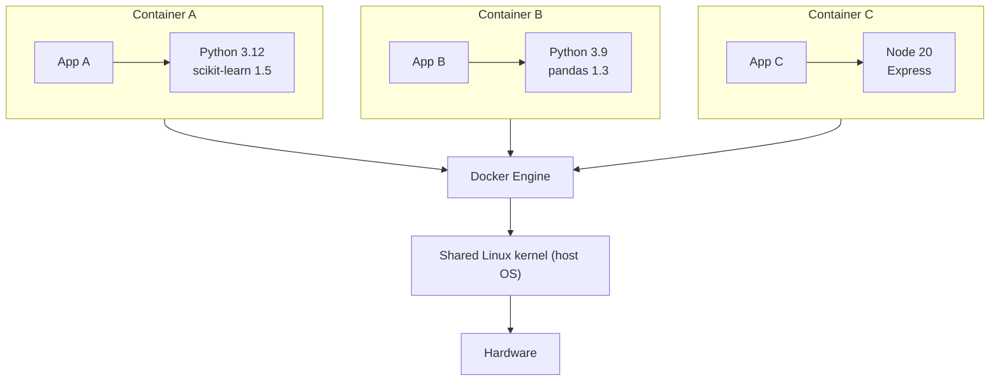
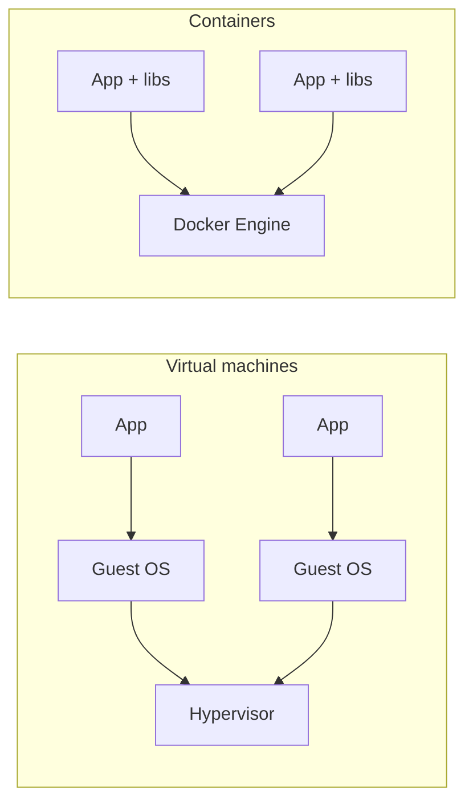
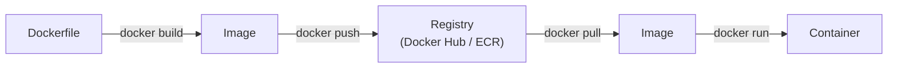
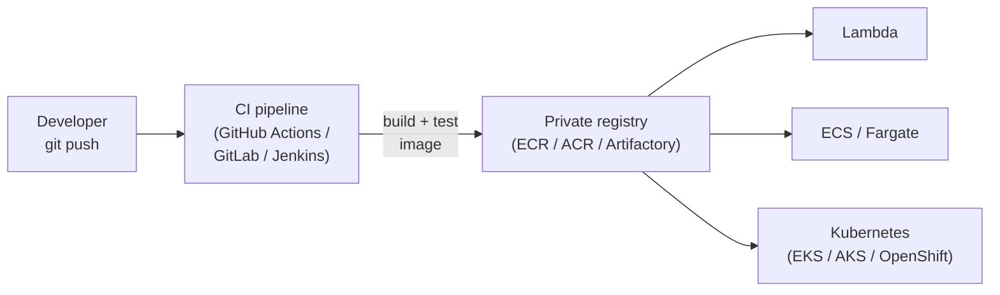
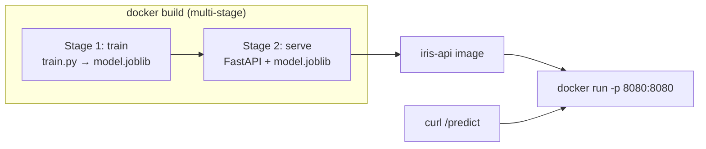
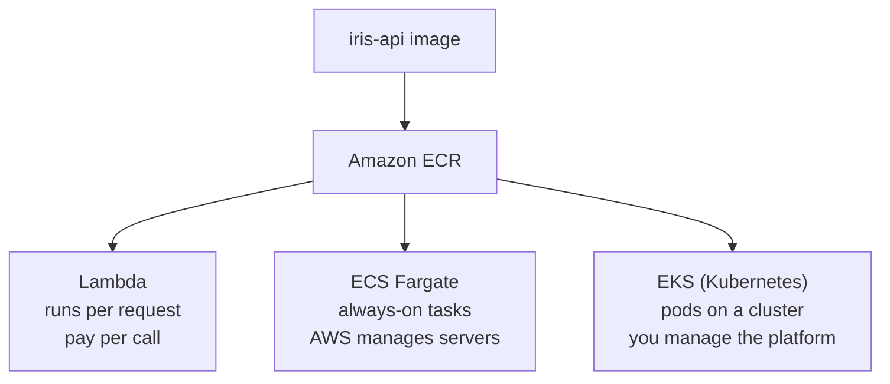
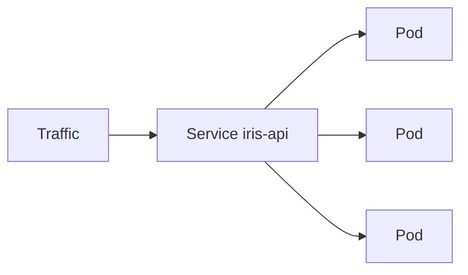
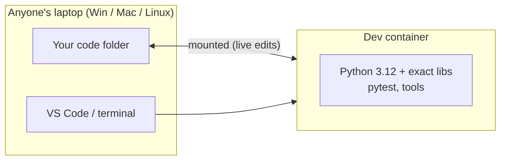
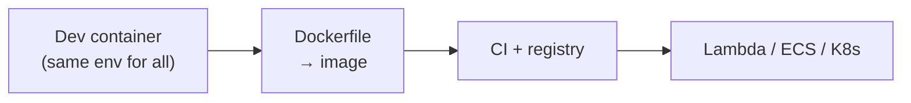

# Docker Containers: From Laptop to AWS

Demo code is in this folder. Every command runs from a Linux shell (Ubuntu on WSL2 here).

---

## 1. What is a container?

One machine and one kernel. Each container brings **its own environment**: its own libraries, runtime versions and files.



**Compared with a virtual machine:** each VM runs a whole guest operating system. A container shares the host's kernel, so it starts in milliseconds and takes up megabytes instead of gigabytes.



**Three words to know**

| Term | Meaning | Analogy |
|---|---|---|
| Dockerfile | Instructions for building an image | Sheet music |
| Image | Built snapshot that can't change | A recording: fixed, and copied anywhere |
| Container | A running instance of an image | Someone playing the recording |

A million people can play the same recording at once, and playing it never changes the recording. In our demo, the recording is the trained model.



---

## 2. How it's typically deployed at customers

<!-- Personalize: swap in the customer names / stacks you've actually seen -->

Across customers, the pattern is almost always the same pipeline. Only the last box changes.



The usual setup:
- **The image is the unit of release.** The same image goes to dev, staging and prod. Only configuration changes, through environment variables and secrets.
- **The registry is private**, and images are often scanned for vulnerabilities before they can be deployed.
- **Infrastructure is code** (Terraform or CDK), not people clicking around in the AWS console.
- **ML models specifically:** the model file is either baked into the image (simple, as in this demo) or pulled from S3 or a model registry at startup (better for big or frequently updated models).

### The demo: wrap a model in a container

Real data: Fisher's 1936 **Iris** measurements (150 flowers, bundled with scikit-learn). The model predicts the species from petal and sepal size. It's a deliberately trivial model.



Files: `model/train.py`, `app/main.py`, `Dockerfile`

```bash
docker build -t iris-api .
docker run --rm -p 8080:8080 iris-api

curl -s -X POST localhost:8080/predict \
  -H "Content-Type: application/json" \
  -d '{"sepal_length":5.1,"sepal_width":3.5,"petal_length":1.4,"petal_width":0.2}'
# {"species":"setosa","confidence":0.98}
```

> Talking point: there's no Python on the host. The build trained the model.

---

## 3. Deploying to AWS: one image, three targets

Every target starts the same way: push the image to ECR (`deploy/push-to-ecr.sh`).



| | Lambda | ECS Fargate | Kubernetes (EKS) |
|---|---|---|---|
| Best for | Spiky / low traffic | Steady web services | Many services, platform teams |
| Scales to zero | Yes | No | No (not by default) |
| Cold start | Yes (seconds) | No | No |
| Ops effort | Lowest | Low | Highest |
| Demo file | `deploy/lambda/` | `deploy/ecs/` | `deploy/k8s/iris.yaml` |

### Lambda
Uses AWS's Lambda base image and a small `handler.py`, with the same `predict()` function as before.
```bash
docker build -f deploy/lambda/Dockerfile -t iris-lambda .
docker run --rm -p 9000:8080 iris-lambda          # built-in local Lambda emulator
curl -s localhost:9000/2015-03-31/functions/function/invocations \
  -d '{"sepal_length":6.7,"sepal_width":3.0,"petal_length":5.2,"petal_width":2.3}'
# real deploy: LAMBDA_ROLE_ARN=... ./deploy/lambda/deploy.sh
```

### ECS Fargate
A **task definition** (which image, CPU and memory, port, health check) plus a **service** ("keep 2 of these running").
```bash
SUBNET=subnet-xxx SG=sg-xxx ./deploy/ecs/deploy.sh
```

### Kubernetes
A **Deployment** ("run 3 replicas, restart them if they fail") plus a **Service** (one stable address in front of them).

```bash
kind create cluster                        # local cluster, runs in Docker itself
kind load docker-image iris-api:latest
kubectl apply -f deploy/k8s/iris.yaml
kubectl port-forward svc/iris-api 8080:80
```

---

## 4. A dev environment that works for everyone

The problem: *"works on my machine."* The fix: ship the **environment** along with the code.



The code stays on your machine and the container supplies everything else. A new teammate needs only **Docker + git**.

**Option A: VS Code Dev Containers** (`.devcontainer/`)
1. Open the folder in VS Code.
2. Click "Reopen in Container".
3. A terminal opens inside the environment, and the model is already trained.

**Option B: plain Docker** (`dev.sh`)
```bash
./dev.sh                       # shell inside the environment
./dev.sh python -m pytest      # run the tests
./dev.sh uvicorn app.main:app --host 0.0.0.0 --port 8080 --reload
```

---

## Recap



One definition of the environment, from the first line of code all the way to production.
